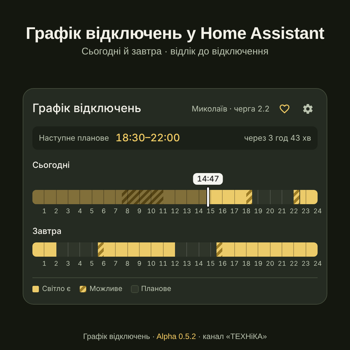
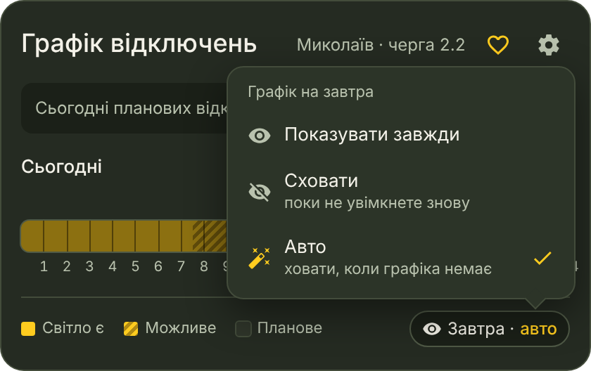
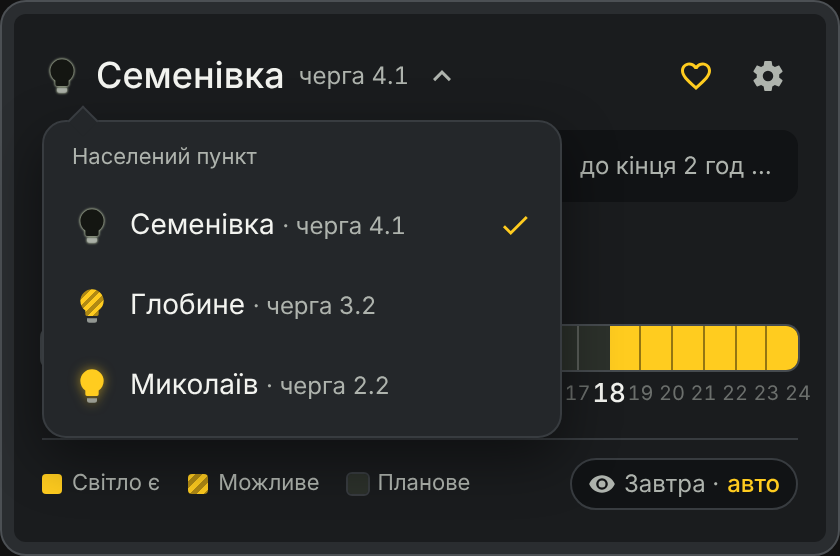
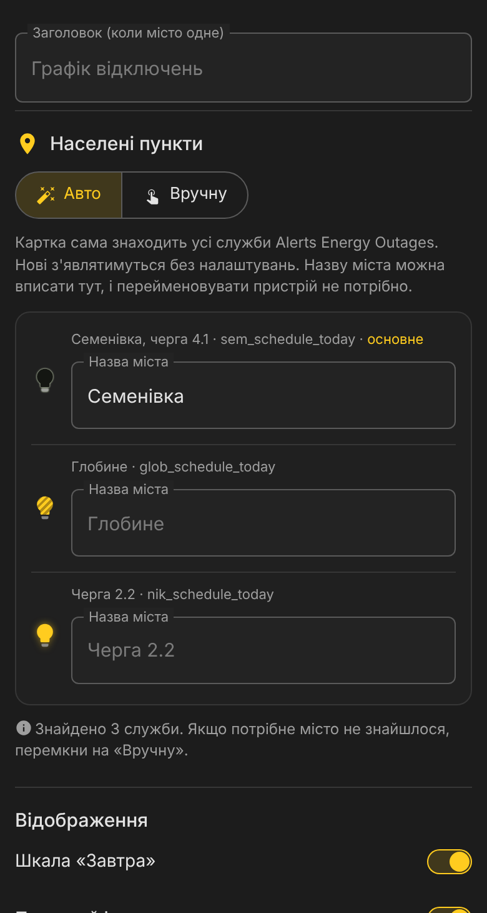
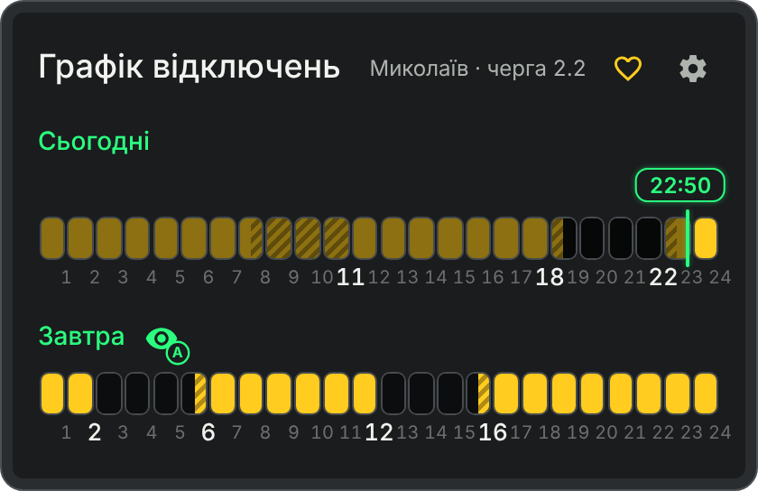

# Графік відключень · ТЕХНіКА

Картка Home Assistant з графіком відключень світла на сьогодні й завтра. Показує наступне планове відключення з відліком часу, поточний час на шкалі й точний інтервал будь-якого періоду за одним дотиком.

Автор: канал [«ТЕХНіКА»](https://www.youtube.com/@TEXHiKA2024).

<p>
  
  
</p>

## Можливості

- Дві шкали: **сьогодні** і **завтра**. Підписи 1–24 стоять на межах годин.
- Шкалу **«Завтра» можна сховати** кнопкою біля її назви: «Показувати завжди», «Сховати» або «Авто» (за замовчуванням). В режимі «Авто» шкала ховається, поки графіка на завтра немає, і з'являється сама, щойно він прийде. Сховану шкалу повертає кнопка «Завтра» в рядку легенди.

<p> </p>
<p></p>
- Кольори: жовтий — світло є, жовті смужки — можливе відключення, темний — планове відключення.
- Верхня плашка показує **наступне планове відключення** і скільки до нього лишилось. Під час відключення там видно, скільки до його кінця.
- Минулий час на шкалі «Сьогодні» притемнено, поточний час позначено рискою.
- **Дотик до шкали** показує тип і точний інтервал періоду. Розмір картки при цьому не змінюється.
- **Кілька населених пунктів в одній картці.** Якщо в інтеграції кілька служб (наприклад, Миколаїв і Семенівка), замість заголовка з'являється назва міста з меню вибору. Лампочка біля кожного міста показує стан зараз: жовта — світло є, смугаста — можливе відключення, чорна — планове. У редакторі картки є режими **Авто** (служби знаходяться самі, назви вписуються поруч) і **Вручну** (блоки з двома сенсорами й кнопкою «Додати населений пункт»).
- **Аварійні відключення (ГАВ).** Картка сама розпізнає ГАВ: помаранчева плашка, рамка навколо шкали і опублікований обленерго графік як орієнтир.
- **Тема ТЕХНіКА.** Картка в корпусі-«дисплеї» з тими самими кольорами екрана, що й «Deye · LCD ТЕХНіКА»: на дашборді обидві виглядають як два екрани одного пристрою. Рамку можна вимкнути в шестерні, перемикач спільний для обох карток.
- **Шестерня на картці** відкриває налаштування: вигляд (смуга, пігулки, кубики), палітра (олива, графіт), тема (авто, світла, темна), рамка, кнопка підтримки. Вибір зберігається у профілі користувача HA і однаковий на всіх пристроях.
- У вікні вибору карток видно **мініпоказ**: якщо сенсори графіка вже є, там одразу твій графік.

<p>
  
  
  
</p>

## Що потрібно

- Home Assistant актуальної версії.
- Одна з інтеграцій графіків, налаштована на твою чергу: **[Svitlo.live](https://github.com/chaichuk/svitlo_live)** (рекомендовано), **[Yasno](https://github.com/denysdovhan/ha-yasno-outages)**, **[DTEK Monitor](https://github.com/groove-max/ha-dtek-monitor)** або **Alerts Energy Outages**. Джерело вибирається в редакторі картки. Картка лише показує їхні дані.

## Встановлення через Магазин (рекомендовано)

У Home Assistant 2026.11 і новіших:

1. **Налаштування → Магазин**, кнопка **Додати з посилання** праворуч угорі.
2. У поле **Посилання на GitHub** встав `https://github.com/hrudkaav/grafik-tehnik` і натисни **Додати**.
3. На вкладці **Переглянути** знайди «Графік відключень ТЕХНіКА» і натисни **Встановити**.
4. Онови сторінку браузера (Ctrl + F5) або перезапусти мобільний застосунок.

Ресурс Магазин додає сам, а про нові версії повідомляє в **Налаштуваннях**: досить натиснути **Оновити**.

<details>
<summary>Home Assistant до 2026.10 з HACS</summary>

1. **HACS → ⋮ → Користувацькі репозиторії** (Custom repositories).
2. Адреса `https://github.com/hrudkaav/grafik-tehnik`, тип **Dashboard** → **Додати**.
3. Знайди «Графік відключень ТЕХНіКА» → **Завантажити** (Download), потім Ctrl + F5.
</details>

## Встановлення вручну

1. Завантаж архів `grafik_tehnik_Alpha_<версія>.zip` з розділу [Releases](https://github.com/hrudkaav/grafik-tehnik/releases). Усередині є файл картки, покрокова PDF-інструкція і коротка TXT-інструкція.
2. Поклади `grafik_tehnik_Alpha_<версія>.js` у папку `/config/www`. Якщо папку створено вперше, перезапусти Home Assistant.
3. Увімкни **Розширений режим** у своєму профілі HA.
4. **Налаштування → Інформаційні панелі → ⋮ → Ресурси → Додати ресурс**: URL `/local/grafik_tehnik_Alpha_<версія>.js`, тип **JavaScript-модуль**.
5. Онови сторінку (Ctrl + F5).

## Додавання картки

**Редагувати інформаційну панель → Додати картку**, у пошуку набери «Графік відключень» і вибери «Графік відключень · ТЕХНіКА». Вкажи сенсори графіка на сьогодні й на завтра, заголовок і підпис.

Або через YAML:

```yaml
type: custom:grafik-tehnik
today_entity: sensor.<графік_на_сьогодні>
tomorrow_entity: sensor.<графік_на_завтра>
title: Графік відключень      # необов'язково
location: Миколаїв            # необов'язково, номер черги дописується сам
show_tomorrow: true           # шкала «Завтра»
show_next: true               # наступне відключення і відлік у верхній плашці
show_legend: true             # легенда кольорів
# Кілька міст. Простіше налаштувати в редакторі картки (Авто / Вручну).
# Авто: назви для інших служб
# names:
#   sensor.<графік_сьогодні_2>: Миколаїв
# Вручну: свій список
# auto_locations: false
# locations:
#   - name: Миколаїв
#     today_entity: sensor.<графік_сьогодні_2>
#     tomorrow_entity: sensor.<графік_завтра_2>
```

> Картка раніше називалася «Світла риска» (`custom:svitla-ryska-card`). Стара назва типу теж працює, тож наявні панелі переналаштовувати не треба.

## Дані сенсора

Візуальний редактор показує сенсори інтеграції Alerts Energy Outages. Через YAML підійде будь-який сенсор з такими атрибутами:

| Атрибут | Значення |
|---|---|
| `date` | дата графіка, `YYYY-MM-DD` |
| `schedule_status` | `published`, `unpublished`, `emergency`, `stale`, `invalid`, `not_found`, `connection_error` |
| `planned_periods` | `[{start: "HH:MM", end: "HH:MM"}]`, крок 30 хв, кінець до `24:00` |
| `possible_periods` | той самий формат |
| `queue`, `operator`, `area` | необов'язково, для підпису і перевірки, що обидва сенсори з однієї черги |

Час рахується за київським часовим поясом.

## Підтримати автора

Картка безкоштовна. Якщо вона тобі корисна, можна підтримати канал:

- Банка monobank «H-Auto та ТЕХНіКА»: https://send.monobank.ua/jar/9TWGTUBwUd
- YouTube: https://www.youtube.com/@TEXHiKA2024

## Проблеми й пропозиції

Пиши в [Issues](https://github.com/hrudkaav/grafik-tehnik/issues): додай скриншот картки, версію (видно у вікні під сердечком) і опис, що саме не так.
